# Trilateration

[](https://github.com/lemmingapex/trilateration/actions/workflows/ci.yml)
[](https://central.sonatype.com/artifact/com.lemmingapex.trilateration/trilateration)
[](https://javadoc.io/doc/com.lemmingapex.trilateration/trilateration)
[](LICENSE)

A Java library for trilateration and multilateration: it estimates an unknown position from the
measured distances to anchors at known positions, such as Bluetooth beacons, Wi-Fi access points,
UWB anchors or acoustic transponders. It works in any number of dimensions (1D, 2D, 3D, ...) and
with latitude and longitude, tolerates noisy and inconsistent measurements, can down-weight
outliers, and reports how uncertain the answer is.



- **Input:** anchor positions (coordinates, or latitude and longitude), measured distances, and
  optionally the uncertainty of each distance
- **Output:** the maximum likelihood position, its residuals, covariance and confidence intervals,
  and a warning when the anchors cannot tell the position from its mirror image

Positions are solved with the [Levenberg-Marquardt algorithm](https://en.wikipedia.org/wiki/Levenberg%E2%80%93Marquardt_algorithm)
from [Hipparchus](https://hipparchus.org/). Requires Java 17 or newer.

## Installation

Gradle (Kotlin DSL):

```kotlin
dependencies {
    implementation("com.lemmingapex.trilateration:trilateration:2.0.0")
}
```

Gradle (Groovy DSL):

```groovy
dependencies {
    implementation 'com.lemmingapex.trilateration:trilateration:2.0.0'
}
```

Maven:

```xml
<dependency>
    <groupId>com.lemmingapex.trilateration</groupId>
    <artifactId>trilateration</artifactId>
    <version>2.0.0</version>
</dependency>
```

## Usage

```java
import com.lemmingapex.trilateration.TrilaterationResult;
import com.lemmingapex.trilateration.TrilaterationSolver;

double[][] positions = { { 5.0, -6.0 }, { 13.0, -15.0 }, { 21.0, -3.0 }, { 12.4, -21.2 } };
double[] distances = { 8.06, 13.97, 23.32, 15.31 };

TrilaterationResult result = new TrilaterationSolver().solve(positions, distances);

double[] point = result.getPoint();                     // [-0.370, -12.228]
double rms = result.getRms();                           // 0.232, in the unit of the distances
double[] sigma = result.getStandardDeviation().get();   // [0.194, 0.315]
double[] ci95 = result.getConfidenceHalfWidths(0.95).get(); // [0.836, 1.355]: x ± 0.836, y ± 1.355
```

`TrilaterationSolver` is immutable and thread-safe, so create one and reuse it.

### Measurement uncertainty

By default every distance is trusted equally. If you know how noisy each measurement is, pass a
standard deviation per distance. Measurements are then weighted by `1 / sigma²`:

```java
TrilaterationProblem problem = TrilaterationProblem.of(positions, distances)
        .withStandardDeviations(0.5, 0.5, 2.0, 0.5);   // the third anchor is less reliable

TrilaterationResult result = solver.solve(problem);
```

For distances derived from signal strength (RSSI), the error usually grows with range. Model that
with standard deviations proportional to each distance, for example `0.1 * distances[i]`.

### Outliers

Least squares lets a single bad measurement pull the answer away, and ranging by radio regularly
produces them: a blocked or reflected signal reads too long. A robust loss limits their influence:

```java
TrilaterationSolver solver = TrilaterationSolver.builder()
        .robustLoss(RobustLoss.HUBER)    // or RobustLoss.CAUCHY for gross outliers
        .build();
```


In a test with 8 anchors, noise 0.5 and one distance 20 units too long, the mean position error was
5.43 with least squares, 0.58 with Huber and 0.46 with Cauchy. Without outliers, both cost about 3%
in accuracy. Robust fitting needs redundancy (from about `n + 2` anchors in `n` dimensions) and
handles a minority of outliers; the offending measurements show up as large `getResiduals()`.

### Reading the result

| Method | Meaning |
| --- | --- |
| `getPoint()` | The estimated position. |
| `getResiduals()` | Per measurement, `distance(point, anchor) - measured distance`. |
| `getRms()` | Root mean square of the residuals: how well the measurements agree. |
| `getCovariance()` | `n x n` covariance of the position, in squared distance units. |
| `getStandardDeviation()` | Square root of the covariance diagonal: the uncertainty of each coordinate. |
| `getConfidenceHalfWidths(p)` | Per coordinate, the `±` half-width of a confidence interval with probability `p`. |
| `isAmbiguous()`, `getAlternativePoint()` | A different position that fits the measurements about as well (see below). |
| `isDegenerateGeometry()` | The anchors lie exactly on a line (2D) or plane (3D), or there are at most `n` of them. |
| `getIterations()`, `getEvaluations()` | Optimizer diagnostics, totalled over all optimizer runs. |

**Covariance and intervals.** If you supplied standard deviations, the covariance comes straight
from them. Otherwise the noise level is estimated from the residuals, which needs more measurements
than dimensions (at least 3 anchors in 2D, 4 in 3D). With few spare measurements that estimate is
itself uncertain, so `getConfidenceHalfWidths` uses Student-t quantiles: with 2 spare measurements a
95% interval is ±4.30 standard deviations, not ±1.96. When the noise cannot be estimated, or the
geometry leaves a direction unconstrained, these methods return empty.

### Ambiguous solutions

A unique position needs at least `n + 1` anchors that do not all lie in a common hyperplane:
3 non-collinear anchors in 2D, 4 non-coplanar anchors in 3D. When the anchors are on, or close to,
a line (2D) or plane (3D), the position and its mirror image across that line or plane fit the
measurements about equally well. The solver then returns the better of the two and reports the other:



```java
if (result.isAmbiguous()) {
    double[] other = result.getAlternativePoint().get();
    // decide with outside knowledge, e.g. the previous position
}
```

To steer the choice, give a starting point on the side you expect. On a tie, the solution the
optimizer reaches from your starting point is kept:

```java
TrilaterationProblem problem = TrilaterationProblem.of(positions, distances)
        .withInitialGuess(previousPosition);
```

### Latitude and longitude

Latitude and longitude are angles, not distances, so they cannot go to the solver directly.
`GeodeticFrame` converts them to metres east, north and up of an origin near the anchors, on the
WGS84 ellipsoid that GNSS receivers use, and converts the answer back:

```java
double[][] anchors = {
        { 40.01490, -105.26970 },   // latitude, longitude in degrees
        { 40.01520, -105.26890 },
        { 40.01430, -105.26850 },
        { 40.01410, -105.26960 } };
double[] distances = { 51.1, 62.2, 72.3, 73.5 };   // metres

GeodeticFrame frame = GeodeticFrame.around(anchors);
TrilaterationResult result = solver.solve(frame.toLocal(anchors), distances);

double[] latLon = frame.toGeodetic(result.getPoint());   // [40.014681, -105.269180]
double[] sigma = result.getStandardDeviation().get();   // [0.40, 0.36] metres east and north
```

Add an altitude in metres, `{ latitude, longitude, altitude }`, to solve in 3D. The local frame is
an exact rotation of Earth-centred coordinates, so 3D distances are preserved at any scale. In 2D,
the points are projected onto a flat plane, which changes distances by about 3 mm at 10 km and 3 m
at 100 km. Use 3D when the anchors are much higher or lower than the target.
`GeodeticFrame.around` handles anchors on both sides of the 180° meridian. To choose the
origin and the height of the 2D plane yourself, use `GeodeticFrame.at(latitude, longitude, altitude)`.

### Solver settings

```java
TrilaterationSolver solver = TrilaterationSolver.builder()
        .robustLoss(RobustLoss.HUBER)       // default RobustLoss.NONE (least squares)
        .mirrorCheck(true)                  // default true, see "How it works"
        .maxEvaluations(400)                // per optimizer run, default 1000
        .costRelativeTolerance(1e-8)        // default 1e-10
        .parameterRelativeTolerance(1e-8)   // default 1e-10
        .build();
```

A typical run needs 5 to 15 model evaluations, and every iteration needs at least one, so
`maxEvaluations` bounds the iterations too. If the optimizer does not converge within the limit,
`solve` throws `TrilaterationException`.
Invalid input (mismatched lengths, negative or non-finite distances, ...) throws
`IllegalArgumentException` when the problem is created.

### Visualizing 2D results

`TrilaterationSvg` draws a two-dimensional result as an SVG image: the distance circles, the
anchors, the estimate with its confidence region, each measurement's residual and, when the result
is ambiguous, the alternative, on a coordinate grid with a legend. It needs no graphics libraries,
has its own light and dark colours, and gives each anchor a tooltip with its distance and residual.
The static figures in this README are drawn with it.

```java
TrilaterationProblem problem = TrilaterationProblem.of(positions, distances);
TrilaterationResult result = solver.solve(problem);

String svg = TrilaterationSvg.render(problem, result);
Files.write(Paths.get("solution.svg"), svg.getBytes(StandardCharsets.UTF_8));

// Or with options:
String labelled = TrilaterationSvg.builder()
        .width(640)            // pixels, default 480
        .confidence(0.99)      // ellipse coverage, default 0.95
        .labels(true)          // number the anchors, label the estimate
        .wholeCircles(true)    // fit every circle; by default large ones are cropped
        .residuals(false)      // hide the residual segments (shown by default)
        .legend(false)         // hide the legend (shown by default)
        .build()
        .toSvg(problem, result);
```

## Applications

Anything that measures distances to points at known positions can be located with this library.
Common uses:

- **Indoor positioning with Bluetooth or Wi-Fi.** A phone or tag estimates its distance to fixed
  beacons or access points from signal strength (RSSI) or from Wi-Fi round-trip time (RTT). RSSI
  distances are coarse and get worse with range, so pass standard deviations proportional to the
  distance, and use a robust loss for signals reflected off walls
  (see [Measurement uncertainty](#measurement-uncertainty) and [Outliers](#outliers)).
- **Ultra-wideband (UWB) tracking.** UWB two-way ranging measures distances to within about 10 cm,
  which suits warehouse asset tracking, sports tracking and indoor drones. Anchors mounted at a
  single ceiling height are coplanar, so in 3D a position and its mirror image above the ceiling
  fit equally well. `isAmbiguous()` reports this. Mounting anchors at different heights, or
  passing `withInitialGuess`, resolves it.
- **Robot and vehicle localization.** A robot ranging to beacons or landmarks (UWB, ultrasonic,
  radio) solves for its position every cycle. A solve takes microseconds, so this fits inside a
  control loop.
- **Underwater acoustic navigation.** In long-baseline (LBL) systems, a vehicle times acoustic
  pings to transponders on the seabed. The travel times multiplied by the speed of sound are the
  distances. Seabed transponders are often nearly coplanar, so the mirror check matters here, and
  a depth sensor settles any ambiguity.
- **Surveying and layout.** A point is located from tape or laser distance measurements to known
  control points, in a local grid or a projected one such as UTM. The solver works relative to
  the anchors' centroid, so large coordinates keep full precision. The confidence intervals show
  whether the result meets a tolerance.
- **Sensor network self-localization.** A newly installed node is placed from its ranges to nodes
  with known positions, and then serves as an anchor for the next node.
- **Beyond physical space.** The solver works in any number of dimensions. For example, it can
  place a new item into an existing embedding, such as one from multidimensional scaling, given
  the item's distances to items already placed.

### Tracking a moving target

For a moving target, reuse one solver, start each solve from the previous position, and pass the
covariance to a tracking filter as its measurement noise:

```java
TrilaterationProblem problem = TrilaterationProblem.of(anchors, distances)
        .withStandardDeviations(sigmas);
if (previous != null) {
    problem = problem.withInitialGuess(previous);
}
TrilaterationResult fix = solver.solve(problem);
previous = fix.getPoint();
fix.getCovariance().ifPresent(r -> kalmanFilter.update(fix.getPoint(), r));
```


The animation runs this loop with the four anchors of the [latitude and longitude](#latitude-and-longitude)
example. The target laps the route at about 2 m/s. Twice a second, its four ranges are measured with
3 m of noise and solved for a single fix (hollow dots) in the anchors' `GeodeticFrame`. A
constant-velocity Kalman filter (orange) uses each fix's covariance as its measurement noise,
which cuts the RMS error from 3.1 m to 1.8 m. The filter is not part of this library. The
animation uses the `LinearKalmanFilter` from
[hipparchus-filtering](https://hipparchus.org/hipparchus-filtering/), from the same project as
this library's own dependency. Its fix measurement and motion model are the `Fix` and
`ConstantVelocity` classes in
[DocsFigures.java](src/docs/java/com/lemmingapex/trilateration/DocsFigures.java).

### What it does not cover

- **Measuring distances.** You convert raw measurements to distances yourself, for example with
  a path-loss model for RSSI, or by multiplying time of flight by the speed of light or sound.
- **Unknown clock offsets.** GNSS pseudoranges and time difference of arrival (TDOA) measure
  distance plus an unknown offset shared by every measurement. Solving them needs that offset as
  an extra unknown, which this model does not include.
- **Angles.** Locating a position from bearings (triangulation) is a different problem.
- **Distances along the Earth's surface over long ranges.** Range measurements are treated as
  straight lines. Great-circle or geodesic distances over hundreds of kilometres need a geodesic
  library such as GeographicLib.
- **Tracking over time.** Each solve is a single snapshot. Smoothing and prediction belong in a
  filter, as above.

## How it works


The animation replays a real solve, step by step, recorded from the solver itself.

### The model

Anchor `i` sits at a known position $p_i \in \mathbb{R}^n$ and reports a distance
$r_i = \lVert x - p_i \rVert + \varepsilon_i$ to the unknown position $x$, with noise
$\varepsilon_i$ of standard deviation $\sigma_i$. The solver returns

$$
\hat{x} = \arg\min_{x} \sum_{i=1}^{m} w_i f_i(x)^2,
\qquad f_i(x) = \lVert x - p_i \rVert - r_i,
\qquad w_i = \frac{1}{\sigma_i^2}
$$

with $w_i = 1$ when no standard deviations are given. For independent Gaussian noise this is the
maximum likelihood estimate. In tests at moderate noise its error matched the Cramér-Rao lower
bound, the smallest error any unbiased estimator can achieve, to within a few percent. Because the residuals $f_i$ are
range errors, the residuals, RMS and covariance are all in the unit of the input distances.

The residuals are nonlinear in $x$. Their Jacobian has one unit vector per anchor,

$$
\frac{\partial f_i}{\partial x} = \frac{(x - p_i)^\top}{\lVert x - p_i \rVert},
$$

and Levenberg-Marquardt iterates damped Gauss-Newton steps
$(J^\top W J + \lambda D) \delta = -J^\top W f$ until the cost stops decreasing. It converges fast
from a good start, typically in 3 to 6 iterations, but it only finds the minimum nearest to where it
starts. The cost has several minima when the geometry is poor or the noise is large, so the
starting point matters.

### The starting point

The starting point comes from a closed-form linear estimate. Write the anchors relative to their
weighted centroid, $q_i = p_i - c$ with $c = \sum w_i p_i / \sum w_i$, and the unknown as
$y = x - c$. Squaring each range equation gives

$$
\lVert y \rVert^2 - 2 q_i^\top y + \lVert q_i \rVert^2 = r_i^2 .
$$

Every equation contains the same unknown quadratic term $\lVert y \rVert^2$. Subtracting the
weighted mean of all equations (where $\sum w_i q_i = 0$) cancels it and leaves a **linear** system:

$$
2 q_i^\top y = \lVert q_i \rVert^2 - \overline{\lVert q \rVert^2} - r_i^2 + \overline{r^2},
\qquad i = 1, \dots, m
$$

where the bars are weighted means. Each row is scaled by $\sqrt{w_i}$, and the system is solved by
least squares with a singular value decomposition (SVD). This formulation has useful properties:

- **No reference anchor.** Subtracting the mean, instead of one anchor's equation, does not let a
  single noisy anchor skew the estimate.
- **Noise bias cancels.** Noise inflates every $r_i^2$ by about $\sigma^2$ on average, and the
  subtraction removes that constant.
- **Scale-free.** Working relative to the centroid keeps full precision for coordinates far from the
  origin, such as UTM or ECEF.
- **Geometry for free.** The SVD reveals the rank of the anchor layout and the direction $v$ in
  which the anchors are flattest.

With exact measurements this estimate is already the answer, and the optimizer stops after one
iteration. With noise it lands close: in tests, starting from it instead of from the anchors'
centroid cut the share of runs that ended in a wrong local minimum from 15–25% to under 1% for
minimal anchor sets, and halved the iteration count.

**Degenerate anchors.** If the anchors span fewer than $n$ dimensions, for example collinear anchors
in 2D, the linear system only determines the part of $y$ inside the anchors' line or plane. The
remaining distance $h$ off that line or plane follows from Pythagoras, averaged over the anchors:

$$
h^2 = \overline{r_i^2 - \lVert y - q_i \rVert^2},
\qquad x_0 = c + y + h v .
$$

Starting there puts the optimizer next to one of the two mirror-image solutions instead of on the
line between them, where it would stall.

### The mirror check

A second Levenberg-Marquardt run starts from the first solution reflected across the plane in which
the anchors are flattest,

$$
x' = \hat{x} - 2 \big((\hat{x} - c)^\top v\big) v ,
$$

and the solver keeps whichever solution has the lower cost. This catches the most common wrong
minimum, the mirror image, and reduced the remaining local minima by 85–100% in tests. When both
runs end at different points whose costs differ by less than 4 noise variances
($\Delta\chi^2 < 4$, a likelihood ratio of about $e^{-2}$), the measurements cannot tell them apart.
The result is then flagged as ambiguous and the other point is reported. The check roughly doubles
the solve time and can be turned off with `mirrorCheck(false)`.

### Robust losses

With a robust loss $\rho$, the solver minimizes $\sum_i \rho(u_i)$ over the scaled residuals
$u_i = \sqrt{w_i} f_i / s$. The scale $s$ is 1 when standard deviations were given, and otherwise
the robust noise estimate $1.4826 \cdot \mathrm{median}_i |f_i|$. The solver uses
iteratively reweighted least squares: it repeats the least squares fit with extra weights
$\omega_i = \psi(u_i)/u_i$, recomputed from the latest residuals, until they settle.

| Loss | Weight $\omega(u)$ | Behaviour |
| --- | --- | --- |
| `HUBER` ($k = 1.345$) | $1$ if $\lvert u\rvert \le k$, else $k/\lvert u\rvert$ | Convex, outliers keep a little influence |
| `CAUCHY` ($k = 2.385$) | $1 / (1 + (u/k)^2)$ | Influence falls to zero, best for gross outliers |

### Uncertainty

The covariance is the usual linearized estimate,

$$
\Sigma = \hat{\sigma}^2 \big(J^\top W J\big)^{-1},
\qquad
\hat{\sigma}^2 = \frac{\sum_i w_i f_i^2}{m - n},
$$

with $\hat{\sigma}^2 = 1$ when standard deviations were given. The inverse is computed with a
single SVD of the small $n \times n$ matrix, which also detects directions the geometry leaves
unconstrained. Confidence half-widths are $t_{m-n} \sqrt{\Sigma_{jj}}$, using a Student-t
quantile when $\hat{\sigma}$ is estimated and a normal quantile when it is known. In tests with
well-spread anchors the 95% intervals covered the true position 94.7–95.2% of the time. With
nearly flat anchor layouts the error can be bimodal (the mirror image), which no covariance can
describe; check `isAmbiguous()`.

### Performance

A solve with the default settings takes about 10 µs for 4 anchors in 2D and 18 µs for 8 anchors in
3D on a recent laptop. Without the mirror check, it takes about half that. A robust loss adds
roughly 4–5× because of the reweighting rounds.

## Building from source

Requires JDK 17 or newer.

```sh
./gradlew build        # compile, test, Javadoc and coverage report
./gradlew test         # tests only; reports in build/reports/tests/test
```

On Windows, use `gradlew.bat` instead of `./gradlew`.

See [CONTRIBUTING.md](CONTRIBUTING.md) for development and release notes, and
[CHANGELOG.md](CHANGELOG.md) for version history.

## License

[MIT](LICENSE)
