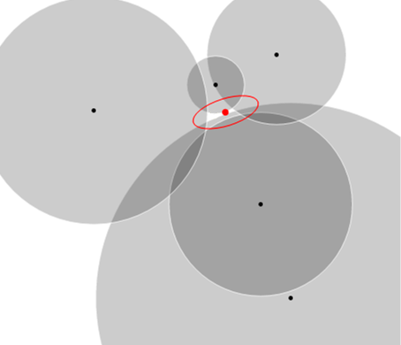

# Trilateration

[](https://github.com/lemmingapex/trilateration/actions/workflows/ci.yml)
[](https://central.sonatype.com/artifact/com.lemmingapex.trilateration/trilateration)
[](https://javadoc.io/doc/com.lemmingapex.trilateration/trilateration)
[](LICENSE)



A small Java library that estimates an unknown position from the known positions of anchors and the
measured distance to each one. It works in any number of dimensions (1D, 2D, 3D, ...), tolerates
noisy and inconsistent measurements, can down-weight outliers, and reports how uncertain the answer is.

- **Input:** anchor positions, measured distances, and optionally the uncertainty of each distance
- **Output:** the maximum likelihood position, its residuals, covariance and confidence intervals,
  and a warning when the anchors cannot tell the position from its mirror image

Positions are solved with the [Levenberg-Marquardt algorithm](https://en.wikipedia.org/wiki/Levenberg%E2%80%93Marquardt_algorithm)
from [Hipparchus](https://hipparchus.org/). Requires Java 8 or newer.

## Installation

Gradle (Kotlin DSL):

```kotlin
dependencies {
    implementation("com.lemmingapex.trilateration:trilateration:2.0.0")
}
```

Gradle (Groovy DSL):

```groovy
dependencies {
    implementation 'com.lemmingapex.trilateration:trilateration:2.0.0'
}
```

Maven:

```xml
<dependency>
    <groupId>com.lemmingapex.trilateration</groupId>
    <artifactId>trilateration</artifactId>
    <version>2.0.0</version>
</dependency>
```

## Usage

```java
import com.lemmingapex.trilateration.TrilaterationResult;
import com.lemmingapex.trilateration.TrilaterationSolver;

double[][] positions = { { 5.0, -6.0 }, { 13.0, -15.0 }, { 21.0, -3.0 }, { 12.4, -21.2 } };
double[] distances = { 8.06, 13.97, 23.32, 15.31 };

TrilaterationResult result = new TrilaterationSolver().solve(positions, distances);

double[] point = result.getPoint();                     // [-0.370, -12.228]
double rms = result.getRms();                           // 0.232, in the unit of the distances
double[] sigma = result.getStandardDeviation().get();   // [0.194, 0.315]
double[] ci95 = result.getConfidenceHalfWidths(0.95).get(); // [0.836, 1.355]: x ± 0.836, y ± 1.355
```

`TrilaterationSolver` is immutable and thread-safe, so create one and reuse it.

### Measurement uncertainty

By default every distance is trusted equally. If you know how noisy each measurement is, pass a
standard deviation per distance. Measurements are then weighted by `1 / sigma²`:

```java
TrilaterationProblem problem = TrilaterationProblem.of(positions, distances)
        .withStandardDeviations(0.5, 0.5, 2.0, 0.5);   // the third anchor is less reliable

TrilaterationResult result = solver.solve(problem);
```

For distances derived from signal strength (RSSI), the error usually grows with range. Model that
with standard deviations proportional to each distance, for example `0.1 * distances[i]`.

### Outliers

Least squares lets a single bad measurement pull the answer away, and ranging by radio regularly
produces them: a blocked or reflected signal reads too long. A robust loss limits their influence:

```java
TrilaterationSolver solver = TrilaterationSolver.builder()
        .robustLoss(RobustLoss.HUBER)    // or RobustLoss.CAUCHY for gross outliers
        .build();
```

In a test with 8 anchors, noise 0.5 and one distance 20 units too long, the mean position error was
5.43 with least squares, 0.58 with Huber and 0.46 with Cauchy. Without outliers, both cost about 3%
in accuracy. Robust fitting needs redundancy (from about `n + 2` anchors in `n` dimensions) and
handles a minority of outliers; the offending measurements show up as large `getResiduals()`.

### Reading the result

| Method | Meaning |
| --- | --- |
| `getPoint()` | The estimated position. |
| `getResiduals()` | Per measurement, `distance(point, anchor) - measured distance`. |
| `getRms()` | Root mean square of the residuals: how well the measurements agree. |
| `getCovariance()` | `n x n` covariance of the position, in squared distance units. |
| `getStandardDeviation()` | Square root of the covariance diagonal: the uncertainty of each coordinate. |
| `getConfidenceHalfWidths(p)` | Per coordinate, the `±` half-width of a confidence interval with probability `p`. |
| `isAmbiguous()`, `getAlternativePoint()` | A different position that fits the measurements about as well (see below). |
| `isDegenerateGeometry()` | The anchors lie exactly on a line (2D) or plane (3D), or there are at most `n` of them. |
| `getIterations()`, `getEvaluations()` | Optimizer diagnostics, totalled over all optimizer runs. |

**Covariance and intervals.** If you supplied standard deviations, the covariance comes straight
from them. Otherwise the noise level is estimated from the residuals, which needs more measurements
than dimensions (at least 3 anchors in 2D, 4 in 3D). With few spare measurements that estimate is
itself uncertain, so `getConfidenceHalfWidths` uses Student-t quantiles: with 2 spare measurements a
95% interval is ±4.30 standard deviations, not ±1.96. When the noise cannot be estimated, or the
geometry leaves a direction unconstrained, these methods return empty.

### Ambiguous solutions

A unique position needs at least `n + 1` anchors that do not all lie in a common hyperplane:
3 non-collinear anchors in 2D, 4 non-coplanar anchors in 3D. When the anchors are on, or close to,
a line (2D) or plane (3D), the position and its mirror image across that line or plane fit the
measurements about equally well. The solver then returns the better of the two and reports the other:

```java
if (result.isAmbiguous()) {
    double[] other = result.getAlternativePoint().get();
    // decide with outside knowledge, e.g. the previous position
}
```

To steer the choice, give a starting point on the side you expect. On a tie, the solution the
optimizer reaches from your starting point is kept:

```java
TrilaterationProblem problem = TrilaterationProblem.of(positions, distances)
        .withInitialGuess(previousPosition);
```

### Solver settings

```java
TrilaterationSolver solver = TrilaterationSolver.builder()
        .robustLoss(RobustLoss.HUBER)       // default RobustLoss.NONE (least squares)
        .mirrorCheck(true)                  // default true, see "How it works"
        .maxIterations(200)                 // per optimizer run, default 1000
        .maxEvaluations(400)                // per optimizer run, default 1000
        .costRelativeTolerance(1e-8)        // default 1e-10
        .parameterRelativeTolerance(1e-8)   // default 1e-10
        .build();
```

If the optimizer does not converge within these limits, `solve` throws `TrilaterationException`.
Invalid input (mismatched lengths, negative or non-finite distances, ...) throws
`IllegalArgumentException` when the problem is created.

## How it works

### The model

Anchor `i` sits at a known position $p_i \in \mathbb{R}^n$ and reports a distance
$r_i = \lVert x - p_i \rVert + \varepsilon_i$ to the unknown position $x$, with noise
$\varepsilon_i$ of standard deviation $\sigma_i$. The solver returns

$$
\hat{x} = \arg\min_{x} \sum_{i=1}^{m} w_i \, f_i(x)^2,
\qquad f_i(x) = \lVert x - p_i \rVert - r_i,
\qquad w_i = \frac{1}{\sigma_i^2}
$$

with $w_i = 1$ when no standard deviations are given. For independent Gaussian noise this is the
maximum likelihood estimate. In tests at moderate noise its error matched the Cramér-Rao lower
bound, the smallest error any unbiased estimator can achieve, to within a few percent. Because the residuals $f_i$ are
range errors, the residuals, RMS and covariance are all in the unit of the input distances.

The residuals are nonlinear in $x$. Their Jacobian has one unit vector per anchor,

$$
\frac{\partial f_i}{\partial x} = \frac{(x - p_i)^\top}{\lVert x - p_i \rVert},
$$

and Levenberg-Marquardt iterates damped Gauss-Newton steps
$(J^\top W J + \lambda D)\,\delta = -J^\top W f$ until the cost stops decreasing. It converges fast
from a good start, typically in 3 to 6 iterations, but it only finds the minimum nearest to where it
starts. The cost has several minima when the geometry is poor or the noise is large, so the
starting point matters.

### The starting point

The starting point comes from a closed-form linear estimate. Write the anchors relative to their
weighted centroid, $q_i = p_i - c$ with $c = \sum w_i p_i / \sum w_i$, and the unknown as
$y = x - c$. Squaring each range equation gives

$$
\lVert y \rVert^2 - 2\, q_i^\top y + \lVert q_i \rVert^2 = r_i^2 .
$$

Every equation contains the same unknown quadratic term $\lVert y \rVert^2$. Subtracting the
weighted mean of all equations (where $\sum w_i q_i = 0$) cancels it and leaves a **linear** system:

$$
2\, q_i^\top y \;=\; \lVert q_i \rVert^2 - \overline{\lVert q \rVert^2} \;-\; r_i^2 + \overline{r^2},
\qquad i = 1, \dots, m
$$

where the bars are weighted means. Each row is scaled by $\sqrt{w_i}$, and the system is solved by
least squares with a singular value decomposition (SVD). This formulation has useful properties:

- **No reference anchor.** Subtracting the mean, instead of one anchor's equation, does not let a
  single noisy anchor skew the estimate.
- **Noise bias cancels.** Noise inflates every $r_i^2$ by about $\sigma^2$ on average, and the
  subtraction removes that constant.
- **Scale-free.** Working relative to the centroid keeps full precision for coordinates far from the
  origin, such as UTM or ECEF.
- **Geometry for free.** The SVD reveals the rank of the anchor layout and the direction $v$ in
  which the anchors are flattest.

With exact measurements this estimate is already the answer, and the optimizer stops after one
iteration. With noise it lands close: in tests, starting from it instead of from the anchors'
centroid cut the share of runs that ended in a wrong local minimum from 15–25% to under 1% for
minimal anchor sets, and halved the iteration count.

**Degenerate anchors.** If the anchors span fewer than $n$ dimensions, for example collinear anchors
in 2D, the linear system only determines the part of $y$ inside the anchors' line or plane. The
remaining distance $h$ off that line or plane follows from Pythagoras, averaged over the anchors:

$$
h^2 = \overline{\, r_i^2 - \lVert y - q_i \rVert^2 \,},
\qquad x_0 = c + y + h\, v .
$$

Starting there puts the optimizer next to one of the two mirror-image solutions instead of on the
line between them, where it would stall.

### The mirror check

A second Levenberg-Marquardt run starts from the first solution reflected across the plane in which
the anchors are flattest,

$$
x' = \hat{x} - 2\,\big((\hat{x} - c)^\top v\big)\, v ,
$$

and the solver keeps whichever solution has the lower cost. This catches the most common wrong
minimum, the mirror image, and reduced the remaining local minima by 85–100% in tests. When both
runs end at different points whose costs differ by less than 4 noise variances
($\Delta\chi^2 < 4$, a likelihood ratio of about $e^{-2}$), the measurements cannot tell them apart.
The result is then flagged as ambiguous and the other point is reported. The check roughly doubles
the solve time and can be turned off with `mirrorCheck(false)`.

### Robust losses

With a robust loss $\rho$, the solver minimizes $\sum_i \rho(u_i)$ over the scaled residuals
$u_i = \sqrt{w_i}\, f_i / s$. The scale $s$ is 1 when standard deviations were given, and otherwise
the robust noise estimate $1.4826 \cdot \operatorname{median}_i |f_i|$. The solver uses
iteratively reweighted least squares: it repeats the least squares fit with extra weights
$\omega_i = \psi(u_i)/u_i$, recomputed from the latest residuals, until they settle.

| Loss | Weight $\omega(u)$ | Behaviour |
| --- | --- | --- |
| `HUBER` ($k = 1.345$) | $1$ if $\lvert u\rvert \le k$, else $k/\lvert u\rvert$ | Convex, outliers keep a little influence |
| `CAUCHY` ($k = 2.385$) | $1 / (1 + (u/k)^2)$ | Influence falls to zero, best for gross outliers |

### Uncertainty

The covariance is the usual linearized estimate,

$$
\Sigma = \hat{\sigma}^2 \,\big(J^\top W J\big)^{-1},
\qquad
\hat{\sigma}^2 = \frac{\sum_i w_i f_i^2}{m - n},
$$

with $\hat{\sigma}^2 = 1$ when standard deviations were given. The inverse is computed with a
single SVD of the small $n \times n$ matrix, which also detects directions the geometry leaves
unconstrained. Confidence half-widths are $t_{m-n}\,\sqrt{\Sigma_{jj}}$, using a Student-t
quantile when $\hat{\sigma}$ is estimated and a normal quantile when it is known. In tests with
well-spread anchors the 95% intervals covered the true position 94.7–95.2% of the time. With
nearly flat anchor layouts the error can be bimodal (the mirror image), which no covariance can
describe; check `isAmbiguous()`.

### Performance

A solve with the default settings takes about 10 µs for 4 anchors in 2D and 18 µs for 8 anchors in
3D on a recent laptop. Without the mirror check, it takes about half that. A robust loss adds
roughly 4–5× because of the reweighting rounds.

### Further reading

Willy Hereman, *Trilateration: The Mathematics Behind a Local Positioning System*, talk at Turgut
Özal University, Ankara, 2011 (Colorado School of Mines, <http://inside.mines.edu/~whereman/>)
covers the linear and nonlinear least squares formulations in more depth.

## Building from source

Requires JDK 17 or newer to build; the published jar targets Java 8.

```sh
./gradlew build        # compile, test, Javadoc and coverage report
./gradlew test         # tests only; reports in build/reports/tests/test
```

On Windows, use `gradlew.bat` instead of `./gradlew`.

See [CONTRIBUTING.md](CONTRIBUTING.md) for development and release notes, and
[CHANGELOG.md](CHANGELOG.md) for version history.

## License

[MIT](LICENSE)
