# Linear trilateration in 2D

This note derives the closed-form linear solution to the two-dimensional trilateration problem,
step by step, and works through it with numbers. The library uses this estimate as the starting
point for its nonlinear solver (see [How it works](../README.md#the-starting-point) in the README).
The same steps carry over to any number of dimensions.

## The problem

There are $m$ anchors at known positions $(x_i, y_i)$, and a measured distance $r_i$ from each
anchor to an unknown point $(x, y)$. Without noise, the point lies on every circle:

$$
(x - x_i)^2 + (y - y_i)^2 = r_i^2, \qquad i = 1, \dots, m .
$$

These equations are quadratic in $x$ and $y$. Expanding one of them gives

$$
x^2 + y^2 - 2 x_i x - 2 y_i y + x_i^2 + y_i^2 = r_i^2 .
$$

The key observation is that the quadratic part, $x^2 + y^2$, is **the same in every equation**. It
does not depend on $i$. Subtracting one equation from another cancels it and leaves an equation that
is linear in $x$ and $y$.

## Method 1: subtract a reference anchor

Take anchor 1 as the reference and subtract its equation from the equation of every other anchor
$i = 2, \dots, m$:

$$
\big(x^2 + y^2 - 2 x_i x - 2 y_i y + x_i^2 + y_i^2\big)
- \big(x^2 + y^2 - 2 x_1 x - 2 y_1 y + x_1^2 + y_1^2\big)
= r_i^2 - r_1^2 .
$$

The $x^2 + y^2$ terms cancel. Moving the constants to the right:

$$
2 (x_i - x_1)\, x + 2 (y_i - y_1)\, y = r_1^2 - r_i^2 + x_i^2 + y_i^2 - x_1^2 - y_1^2 .
$$

Call the coefficients $a_i = 2 (x_i - x_1)$, $b_i = 2 (y_i - y_1)$ and the right side $k_i$.
Stacking the $m - 1$ equations gives a linear system $A \mathbf{u} = \mathbf{k}$:

$$
\underbrace{\begin{bmatrix} a_2 & b_2 \\ a_3 & b_3 \\ \vdots & \vdots \\ a_m & b_m \end{bmatrix}}_{A}
\begin{bmatrix} x \\ y \end{bmatrix}
=
\underbrace{\begin{bmatrix} k_2 \\ k_3 \\ \vdots \\ k_m \end{bmatrix}}_{\mathbf{k}} .
$$

**Geometric meaning.** Each of these linear equations is a straight line: the *radical axis* of
circle 1 and circle $i$. When two circles intersect, their radical axis is the line through both
intersection points. The unknown point lies on every radical axis, so it is where they cross.

With three anchors there are three pairs of circles, but only two independent axes: the equation
for circles 2 and 3 is the difference of those for 1 and 3 and for 1 and 2. That is why the third
axis always passes through the crossing of the other two, even when the distances are noisy and
the circles do not all meet at one point. With four or more noisy anchors the axes no longer meet
at a single point, and least squares chooses the point that fits them best.

### Three anchors: Cramer's rule

With exactly three anchors, $A$ is $2 \times 2$ and the system can be solved directly:

$$
x = \frac{k_2 b_3 - k_3 b_2}{a_2 b_3 - a_3 b_2},
\qquad
y = \frac{a_2 k_3 - a_3 k_2}{a_2 b_3 - a_3 b_2} .
$$

The determinant is

$$
a_2 b_3 - a_3 b_2 = 4 \big[(x_2 - x_1)(y_3 - y_1) - (x_3 - x_1)(y_2 - y_1)\big],
$$

which is 8 times the signed area of the triangle formed by the three anchors. It is zero exactly
when the anchors are collinear, which is the one layout where three distances cannot fix a 2D
position (see [Collinear anchors](#collinear-anchors)).

**Example.** Anchors at $(0, 0)$, $(10, 0)$ and $(0, 10)$, and a point at $(3, 4)$, so the
distances are $r_1 = 5$, $r_2 = \sqrt{65}$ and $r_3 = \sqrt{45}$. Then

$$
\begin{aligned}
a_2 &= 20, & b_2 &= 0, & k_2 &= 25 - 65 + 100 - 0 = 60, \\
a_3 &= 0, & b_3 &= 20, & k_3 &= 25 - 45 + 100 - 0 = 80,
\end{aligned}
$$

and $x = 60 \cdot 20 / 400 = 3$, $y = 20 \cdot 80 / 400 = 4$.

### More anchors: least squares

With four or more anchors there are more equations than unknowns. With noisy distances they have
no exact common solution, so the system is solved in the least squares sense, minimizing
$\lVert A \mathbf{u} - \mathbf{k} \rVert^2$. The minimum satisfies the normal equations
$A^\top A\, \mathbf{u} = A^\top \mathbf{k}$, which in 2D are a $2 \times 2$ system:

$$
\begin{bmatrix} \sum a_i^2 & \sum a_i b_i \\ \sum a_i b_i & \sum b_i^2 \end{bmatrix}
\begin{bmatrix} x \\ y \end{bmatrix}
=
\begin{bmatrix} \sum a_i k_i \\ \sum b_i k_i \end{bmatrix} .
$$

### The weakness of a reference anchor

The reference anchor's distance $r_1$ appears in every row of $\mathbf{k}$. If that one measurement
is noisy, its error shifts every equation the same way, and the estimate depends on which anchor
was picked as the reference. The [worked example](#worked-example) below shows how much: the four
possible choices of reference give estimates up to 0.5 units apart.

## Method 2: subtract the mean

Instead of subtracting one anchor's equation, subtract the **average** of all of them. Every anchor
is then treated alike. It is also convenient to measure positions from the anchors' centroid

$$
\bar{x} = \frac{1}{m} \sum_{i=1}^{m} x_i, \qquad \bar{y} = \frac{1}{m} \sum_{i=1}^{m} y_i .
$$

Write the anchors and the unknown point relative to it:

$$
X_i = x_i - \bar{x}, \quad Y_i = y_i - \bar{y}, \qquad X = x - \bar{x}, \quad Y = y - \bar{y} .
$$

By construction, the centered anchors sum to zero: $\sum X_i = \sum Y_i = 0$. Distances do not
change under a shift, so the circle equations read the same in centered coordinates:

$$
X^2 + Y^2 - 2 X_i X - 2 Y_i Y + X_i^2 + Y_i^2 = r_i^2 .
\tag{1}
$$

Average equation (1) over all $m$ anchors. Because $\sum X_i = \sum Y_i = 0$, the linear terms
vanish:

$$
X^2 + Y^2 + \overline{X_i^2 + Y_i^2} = \overline{r_i^2},
\tag{2}
$$

where the bar denotes the average over the anchors. Subtracting (2) from (1) cancels the quadratic
term, as before:

$$
2 X_i X + 2 Y_i Y = \big(X_i^2 + Y_i^2\big) - \overline{X_i^2 + Y_i^2} - r_i^2 + \overline{r_i^2}
\qquad i = 1, \dots, m .
\tag{3}
$$

This gives $m$ linear equations, one per anchor, with no anchor singled out.

### Solving it

Call the right side of (3) $k_i$. The least squares normal equations are

$$
\begin{bmatrix} \sum 4 X_i^2 & \sum 4 X_i Y_i \\ \sum 4 X_i Y_i & \sum 4 Y_i^2 \end{bmatrix}
\begin{bmatrix} X \\ Y \end{bmatrix}
=
\begin{bmatrix} \sum 2 X_i k_i \\ \sum 2 Y_i k_i \end{bmatrix} .
$$

Two simplifications follow from $\sum X_i = \sum Y_i = 0$.

First, the matrix on the left is 4 times the **scatter matrix** of the anchors,

$$
S = \begin{bmatrix} S_{xx} & S_{xy} \\ S_{xy} & S_{yy} \end{bmatrix}
= \begin{bmatrix} \sum X_i^2 & \sum X_i Y_i \\ \sum X_i Y_i & \sum Y_i^2 \end{bmatrix} ,
$$

which describes only how the anchors are spread out. The measurements do not enter it.

Second, the two averages in $k_i$ are the same for every $i$, so they drop out of $\sum X_i k_i$
and $\sum Y_i k_i$. Only the per-anchor part remains:

$$
\sum_i X_i k_i = \sum_i X_i \big(X_i^2 + Y_i^2 - r_i^2\big) .
$$

Dividing both sides by 4, the system becomes $S \, [X, Y]^\top = [g_x, g_y]^\top$ with

$$
g_x = \tfrac{1}{2} \sum_i X_i \big(X_i^2 + Y_i^2 - r_i^2\big),
\qquad
g_y = \tfrac{1}{2} \sum_i Y_i \big(X_i^2 + Y_i^2 - r_i^2\big),
$$

and inverting the $2 \times 2$ matrix gives the closed form

$$
X = \frac{S_{yy}\, g_x - S_{xy}\, g_y}{D},
\qquad
Y = \frac{S_{xx}\, g_y - S_{xy}\, g_x}{D},
\qquad
D = S_{xx} S_{yy} - S_{xy}^2 .
$$

The estimate is $x = \bar{x} + X$, $y = \bar{y} + Y$.

### Why it behaves well

- **No reference anchor.** Every anchor enters the same way, so one noisy distance does not shift
  every equation.
- **Noise bias cancels.** With noise $\varepsilon_i$ of standard deviation $\sigma$, the squared
  distance $r_i^2 = (d_i + \varepsilon_i)^2$ is on average $d_i^2 + \sigma^2$, too large by the same
  $\sigma^2$ for every anchor. A constant added to every $r_i^2$ contributes
  $\tfrac{1}{2} \sigma^2 \sum X_i = 0$ to $g_x$ (and likewise to $g_y$), so it has no effect.
- **Precision.** Working relative to the centroid keeps the numbers small. With anchors far from the
  origin, such as UTM coordinates in the hundreds of thousands, squaring the raw coordinates would
  lose most of the significant digits.
- **Geometry in the open.** $D$ is zero exactly when the anchors are collinear, and the eigenvector
  of $S$ with the smaller eigenvalue is the direction in which the anchors are least spread out.
  The solver's [mirror check](../README.md#the-mirror-check) reflects its first solution along
  that direction.

### Weighted measurements

When each distance has a standard deviation $\sigma_i$, give anchor $i$ the weight
$w_i = 1 / \sigma_i^2$ and replace every sum and average with its weighted counterpart: the centroid
becomes $\bar{x} = \sum w_i x_i / \sum w_i$, the scatter matrix $S_{xx} = \sum w_i X_i^2$ (and so
on), and $g_x = \tfrac{1}{2} \sum w_i X_i (X_i^2 + Y_i^2 - r_i^2)$. The derivation is otherwise
unchanged, because it only used $\sum w_i X_i = \sum w_i Y_i = 0$. The noise bias then cancels
exactly when all $\sigma_i$ are equal.

## Collinear anchors

If all anchors lie on one line, $D = 0$ and the system cannot be solved for both coordinates: the
distances cannot tell a point on one side of the line from its mirror image on the other. The
linear equations still determine the position *along* the line.

Let $\mathbf{e}$ be a unit vector along the line and $\mathbf{n}$ a unit vector perpendicular to it.
Each centered anchor is $(X_i, Y_i) = s_i \mathbf{e}$ for some signed position $s_i$ along the line.
Writing the unknown as $t \mathbf{e} + h \mathbf{n}$, equation (3) becomes $2 s_i t = k_i$, and
least squares gives

$$
t = \frac{\sum s_i k_i}{2 \sum s_i^2} .
$$

The distance $h$ from the line then follows from Pythagoras, $r_i^2 = (t - s_i)^2 + h^2$,
averaged over the anchors:

$$
h^2 = \overline{r_i^2 - (t - s_i)^2} .
$$

The two candidates are $(\bar{x}, \bar{y}) + t \mathbf{e} \pm h \mathbf{n}$, and nothing in the
measurements can choose between them. The library starts from one of them and reports the other as
`getAlternativePoint()`.

## Worked example

These are the anchors and distances from the README's [Usage](../README.md#usage) section:

| Anchor | $x_i$ | $y_i$ | $r_i$ |
| --- | ---: | ---: | ---: |
| 1 | 5.0 | −6.0 | 8.06 |
| 2 | 13.0 | −15.0 | 13.97 |
| 3 | 21.0 | −3.0 | 23.32 |
| 4 | 12.4 | −21.2 | 15.31 |

**Centroid.** $\bar{x} = 12.85$, $\bar{y} = -11.3$.

**Centered anchors and the per-anchor term** $X_i^2 + Y_i^2 - r_i^2$:

| Anchor | $X_i$ | $Y_i$ | $X_i^2 + Y_i^2$ | $r_i^2$ | $X_i^2 + Y_i^2 - r_i^2$ |
| --- | ---: | ---: | ---: | ---: | ---: |
| 1 | −7.85 | 5.30 | 89.713 | 64.964 | 24.749 |
| 2 | 0.15 | −3.70 | 13.713 | 195.161 | −181.448 |
| 3 | 8.15 | 8.30 | 135.313 | 543.822 | −408.510 |
| 4 | −0.45 | −9.90 | 98.213 | 234.396 | −136.184 |

**Scatter matrix and right side.**

$$
S = \begin{bmatrix} 128.27 & 29.94 \\ 29.94 & 208.68 \end{bmatrix},
\qquad
D = 25\,870.98,
\qquad
\begin{bmatrix} g_x \\ g_y \end{bmatrix} = \begin{bmatrix} -1744.785 \\ -619.943 \end{bmatrix} .
$$

**Solve.**

$$
X = \frac{208.68 \cdot (-1744.785) - 29.94 \cdot (-619.943)}{25\,870.98} = -13.356,
\qquad
Y = \frac{128.27 \cdot (-619.943) - 29.94 \cdot (-1744.785)}{25\,870.98} = -1.055 .
$$

**Estimate.** $x = 12.85 - 13.356 = -0.506$, $y = -11.3 - 1.055 = -12.355$.

For comparison:

| Method | $x$ | $y$ | RMS of range residuals |
| --- | ---: | ---: | ---: |
| Reference anchor 1 | −0.562 | −12.326 | 0.293 |
| Reference anchor 2 | −0.591 | −12.068 | 0.306 |
| Reference anchor 3 | −0.447 | −12.321 | 0.248 |
| Reference anchor 4 | −0.473 | −12.564 | 0.310 |
| Mean subtraction | −0.506 | −12.355 | 0.272 |
| Nonlinear least squares (the library's answer) | −0.370 | −12.228 | 0.232 |

The reference-anchor estimates move by up to 0.5 units depending on which anchor is the reference.
One of them happens to fit better than the mean-subtraction estimate, but nothing in the data says
in advance which reference to pick. The mean-subtraction estimate needs no such choice and lands
within about 0.2 units of the final answer, a good starting point for the nonlinear solver.

## Why not stop here?

The linear estimate is exact when the distances are, but with noise it is not the best estimate.
Squaring the range equations also squares the errors in them: to first order,
$r_i^2 \approx d_i^2 + 2 d_i \varepsilon_i$, so the error in equation $i$ grows with the distance
$d_i$, and the far anchors get too much say. The linear solution minimizes the error in squared
distances, while the [maximum likelihood estimate](../README.md#the-model) minimizes the error in
the distances themselves. That is a nonlinear problem, which the library solves with Levenberg-Marquardt,
starting from the linear estimate.
